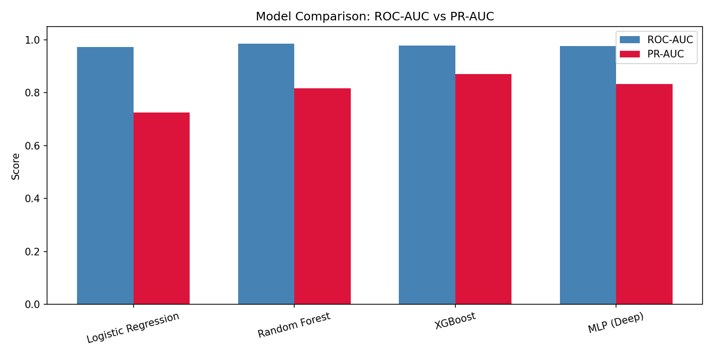

# Credit Card Fraud Detection: Deep Learning vs Classical ML

Detecting fraudulent card transactions in a highly imbalanced dataset (**0.17% fraud**) and comparing an MLP against Logistic Regression, Random Forest and XGBoost – with leakage-free preprocessing, SMOTE, class-weighted / focal losses and PR-AUC as the main metric.


> **CISC 867 – Deep Learning, Queen's University** · Supervisor: Dr. Hazem Abbas
> Team: Bassam Ahmed (team lead – EDA & preprocessing), Ahmed Nafea (classical models), Aya Mohamed (deep model & reporting)

## Results

Test set: 56,962 transactions (98 frauds). With only 0.17% positives, ROC-AUC looks high for every model, so **PR-AUC** is the metric that separates them.

| Model | ROC-AUC | PR-AUC | F1 @ 0.5 | Best F1 (tuned threshold) |
|---|---:|---:|---:|---:|
| Logistic Regression | 0.9731 | 0.7231 | 0.11 | 0.83 |
| Random Forest | 0.9794 | 0.8226 | 0.68 | 0.80 |
| **XGBoost** | **0.9806** | **0.8625** | 0.68 | **0.85** |
| MLP 4-layer + weighted BCE | 0.9673 | 0.8494 | **0.78** | – |
| MLP 5-layer + weighted BCE | 0.9739 | 0.8592 | – | – |

- **XGBoost** has the best PR-AUC. The 5-layer MLP comes within ~0.003 of it but takes ~3× longer to train.
- **Threshold tuning matters**: Logistic Regression goes from F1 0.11 to 0.83 just by moving the decision threshold.
- The MLP ablation also compared **focal loss (γ = 2)** with weighted BCE.



## Approach

**Imbalance handling**
- SMOTE on the training set only (for LR, RF and MLP).
- `scale_pos_weight` for XGBoost on the original training data.
- Class-weighted BCE and focal loss for the MLP.

**Leakage prevention**
- Stratified 70 / 10 / 20 train / validation / test split *before* any scaling or resampling.
- `StandardScaler` fit on the training set only.

**Evaluation**
- PR-AUC (primary), ROC-AUC (for comparison with prior work), F1 at the default and the best threshold.
- `SEED = 42` everywhere for reproducibility.

## Project Structure

```text
├── data/                      # creditcard.csv goes here (not tracked)
├── src/
│   ├── studentA/eda_preprocessing.ipynb   # EDA, split, scaling, SMOTE → saves .npy splits
│   ├── studentB/classical_models.ipynb    # LR, RF, XGBoost, threshold analysis
│   └── studentC/
│       ├── deep_model.ipynb               # MLP training, ablation, final comparison
│       └── report_utils.ipynb             # shared plotting helpers
├── models/                    # saved models (.pkl, .json, .pt)
├── results/                   # plots and summary CSVs
├── LOG.md                     # weekly development log
└── requirements.txt
```

## How to Run

1. Download `creditcard.csv` from [Kaggle](https://www.kaggle.com/datasets/mlg-ulb/creditcardfraud) and put it in `data/`.
2. Install dependencies:

```bash
git clone https://github.com/bssam99/credit-card-fraud-detection.git
cd credit-card-fraud-detection
pip install -r requirements.txt
```

3. Run the notebooks **in order**, from their own folders (paths are relative to the repo root):
   1. `src/studentA/eda_preprocessing.ipynb` – creates the train/val/test `.npy` files in `results/`
   2. `src/studentB/classical_models.ipynb`
   3. `src/studentC/deep_model.ipynb`

No GPU needed – all models were trained on CPU.

## Dataset

[Credit Card Fraud Detection (ULB)](https://www.kaggle.com/datasets/mlg-ulb/creditcardfraud): 284,807 European card transactions from September 2013, 492 frauds, 30 features (V1–V28 are PCA components, plus Time and Amount).

## References

1. Dal Pozzolo et al., *Calibrating Probability with Undersampling for Unbalanced Classification*, IEEE SSCI 2015.
2. Carcillo et al., *SCARFF: A Scalable Framework for Streaming Credit Card Fraud Detection with Spark*, IEEE Big Data 2018.
3. Chawla et al., *SMOTE: Synthetic Minority Over-sampling Technique*, JAIR 2002.
4. Lin et al., *Focal Loss for Dense Object Detection*, ICCV 2017.

## Use of GenAI Tools

Claude (Anthropic) was used to clarify concepts, help with grammar in the written report, and help debug after team members had first tried fixes themselves. All experiments, model design decisions and analysis are the team's own work.
